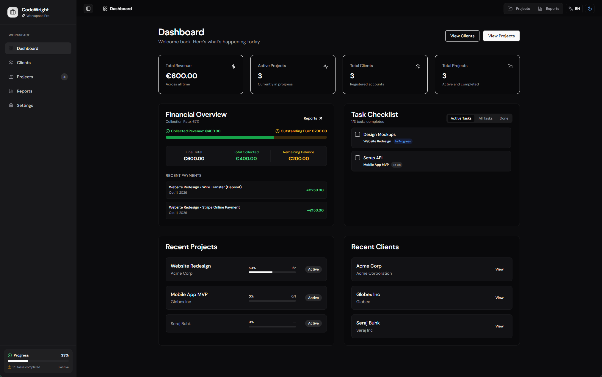

# NexTrack

A modern fullstack client task, project, and financial service tracking application built with React 18, Express, and Drizzle ORM.



---

## Features

- **Project Progress Tracking**: Uniformly aligned visual progress bars calculated dynamically from completed tasks and subtasks across the project list, project detail view, client pages, and the main dashboard.
- **Enhanced Main Menu & Navigation Bar**:
  - Polished modern sidebar with live project counter badges and real-time task completion rate summary.
  - Sticky glass header with contextual page breadcrumb/title, quick project/report navigation links, one-click language selector (6 languages), and theme toggle.
- **Interactive Task Checklist**: Quick-access task checklist on the main dashboard with filter tabs (Active, All, Done) and instant completion toggles.
- **Financial Overview & Payment Tracking**:
  - Record payments against charges with payment date, amount, and notes/methods (Bank wire, Stripe, Cash, etc.).
  - Automatic balance calculations: tracks Total Invoiced, Total Collected, Remaining Balance Due, and status badges (Paid, Partially Paid, Unpaid).
  - Expandable payment history and deletion management.
- **Client Management**: Track clients, contact details, email addresses, and company associations with active/completed project breakdowns.
- **Project Tracking**: Manage projects with active and completed lifecycle statuses, nested task structures, and client associations.
- **Hierarchical Task Management**: Create tasks and nested subtasks with instant completion checkboxes and status workflows.
- **Financial Charge Tracking**: Assign service charges directly to projects and individual tasks with customizable discount percentages (0–100%).
- **Multi-Format Financial Reporting**: Generate professional PDF reports (with embedded UTF-8 fonts) and Word (.docx) invoices with base amounts, discounts, collected payments, and remaining balances.
- **Internationalization (i18n)**: Fully translated into 6 languages:
  - English (`en`)
  - German (`de`)
  - Greek (`el`)
  - Spanish (`es`)
  - French (`fr`)
  - Italian (`it`)
- **Multi-Currency Support**: 13 worldwide currencies with locale-aware symbol placement and formatting (USD, EUR, GBP, JPY, CAD, AUD, CHF, CNY, INR, BRL, MXN, KRW, SEK).
- **Theming & Custom Branding**: Light, dark, and system themes with custom brand favicon, persistent app name, and company logo upload.
- **Zero-Setup Local SQLite**: Works out of the box with SQLite (`better-sqlite3`) with zero database installation required. Automatic table migration and sample demo data seeding on first boot.

---

## Tech Stack

| Layer | Technologies |
|---|---|
| **Frontend** | React 18, Vite, TypeScript, Tailwind CSS, Shadcn/UI, Radix UI, TanStack Query, Wouter |
| **Backend** | Express.js, Drizzle ORM, better-sqlite3 |
| **Reports** | jsPDF + jsPDF-AutoTable (PDF), docx + FileSaver (Word) |
| **Icons & Design** | Lucide React, Framer Motion |

---

## Quick Start (Local Development)

### Prerequisites
- [Node.js](https://nodejs.org/) version 20 or higher.

### 1-Click Startup (Windows)
Double-click `start.bat` in the project directory, or run from PowerShell / Command Prompt:
```cmd
.\start.bat
```
This automatically installs dependencies if needed, starts the dev server, and opens [http://localhost:5000](http://localhost:5000) in your default browser.

### Manual Startup (Any OS)
1. **Install dependencies**:
   ```bash
   npm install
   ```

2. **Start the development server**:
   ```bash
   npm run dev
   ```

3. **Open the application**:
   Navigate to [http://localhost:5000](http://localhost:5000).

> [!NOTE]
> On the first startup, SQLite tables are created automatically and populated with initial demo clients, projects, tasks, and charges. Data is persisted in `nextrack.db`.

---

## Available NPM Scripts

| Script | Description |
|---|---|
| `npm run dev` | Start the local development server with Vite hot reload |
| `npm run build` | Compile the React frontend and bundle the backend server for production |
| `npm start` | Run the compiled production server (`dist/index.cjs`) |
| `npm run check` | Run TypeScript type checks across both client and server |
| `npm run db:push` | Push schema changes to the database using Drizzle Kit |

---

## Project Structure

```
├── client/src/              # React frontend
│   ├── components/          # UI components (Shadcn UI + custom form modals)
│   ├── hooks/               # Custom hooks (i18n, currency, branding, tasks, projects)
│   ├── pages/               # Application routes
│   │   ├── dashboard.tsx    # Dashboard with revenue stats & recent project progress
│   │   ├── clients/         # Client management and individual client views
│   │   ├── projects/        # Project overview with progress bars & task boards
│   │   ├── reports/         # PDF & Word report export center
│   │   └── settings.tsx     # Language, currency, branding, and theme settings
│   └── lib/                 # Utility helpers (formatting, QueryClient)
├── server/                  # Express backend
│   ├── index.ts             # Server entry point & Vite middleware integration
│   ├── routes.ts            # REST API endpoints & demo data seeding
│   ├── storage.ts           # Storage repository layer
│   └── db.ts                # Database connection & table bootstrapping
├── shared/                  # Code shared between frontend and backend
│   ├── schema.ts            # Drizzle ORM schema definitions & Zod schemas
│   └── routes.ts            # Typed API contract definitions
├── start.bat                # 1-Click Windows development launcher
└── drizzle.config.ts        # Drizzle Kit configuration
```

---

## License

MIT
